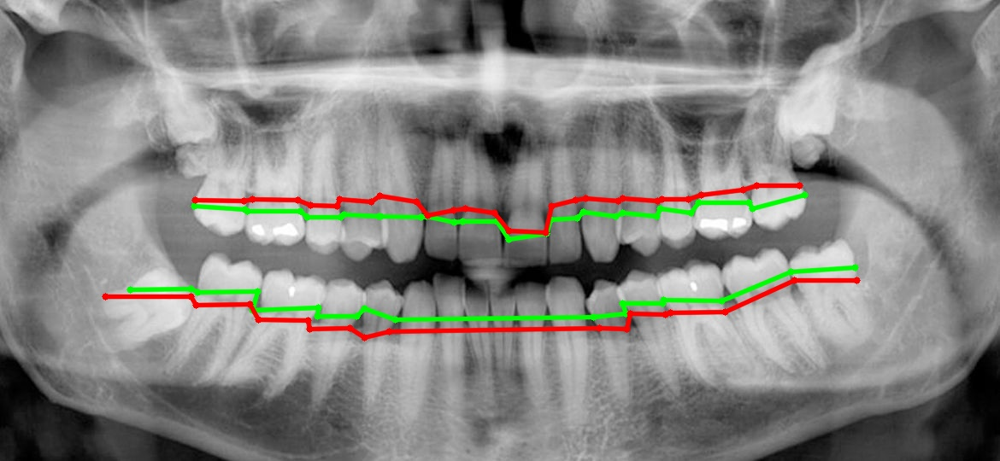
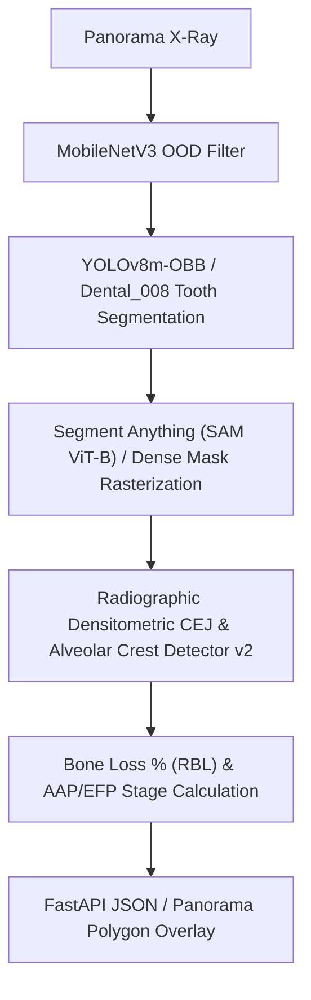

    

# Pano Bone Loss Measurement (Dental_003)

## 개요
> [학습 환경 사양] 실질적 모델 학습은 RTX 5080 + 라이젠9-6 9900X 환경에서 진행되었습니다.

딥러닝을 활용하여 파노라마 방사선 사진에서 치아를 검출(`YOLOv8m-OBB` / `YOLOv11-OBB`)하고, 제로샷 기반 치아 분할(`SAM ViT-B` 또는 `Dental_008` 치아 인스턴스 마스크) 및 치간부 방사선 밀도 프로파일·윤곽 곡률 분석(`radiographic_densitometric_cej_crest_v2`)을 통해 주요 5대 치주 랜드마크(Mesial/Distal CEJ, Mesial/Distal Alveolar Crest, Root Apex)를 추출하여 치주염에 따른 치조골 소실량(RBL, Radiographic Bone Loss)과 병기(AAP/EFP Stage I~IV)를 산출하는 AI 시스템입니다.

## Model Weights (Hugging Face)
본 모듈의 학습된 가중치 모델은 Hugging Face 저장소 및 로컬 `models/` 경로에 연동되어 있습니다:
- [Hugging Face Repository (`chemahc94/Dental-AI-Models`)](https://huggingface.co/chemahc94/Dental-AI-Models/tree/main/Dental_003)
- [Hugging Face Repository (`chemahc94/pano-boneloss-weights`)](https://huggingface.co/chemahc94/pano-boneloss-weights)

FastAPI 서버(`api/main.py`), 통합 파이프라인(`Dental_Panoramic_Reader/core/interfaces/dental_003.py`) 및 Streamlit UI(`app.py`)는 로컬 `models/` / `weights/` 또는 Hugging Face Hub에서 가중치(`best.pt`, `best.onnx`, `sam_vit_b_01ec64.pth`)를 로드하며, 가중치가 존재하지 않을 경우 더미 가중치로 추론하지 않고 명시적으로 `HTTP 503 (Model weights unavailable)`을 반환합니다.

## 설치 및 실행 방법

1. 의존성 설치 및 환경 구성:
   ```bash
   pip install -r requirements.txt
   python scripts/setup_env.py
   ```
2. FastAPI 서버 실행:
   ```bash
   uvicorn api.main:app --host 127.0.0.1 --port 8003
   ```
3. Streamlit UI 실행:
   ```bash
   streamlit run app.py
   ```

## 주요 기능 및 계측 방식 (`radiographic_densitometric_cej_crest_v2`)

### 분석 결과 예시


### Architecture Diagram


### 방사선 밀도 기반 랜드마크 산출 규칙 및 API 응답 명세
- `measurement_method`: `radiographic_densitometric_cej_crest_v2`
  - 치아 마스크 윤곽선에서 상악/하악 방향에 따라 치관 끝단(Crown)과 치근단(Root Apex)을 식별하고, 치경부 구간(`t in [0.20, 0.36]`)에서 법랑질-상아질 방사선 불투과도 경사(`-dI/dt`)와 치경부 협착(`-dW/dt`) 결합 점수가 극대화되는 지점을 좌·우 `CEJ(백악법랑경계)`로 검출합니다.
  - 전체 치아 마스크(`all_teeth_mask`)를 제외 처리한 치간부(Interproximal) 스트립에서 `CLAHE` 방사선 밀도 프로파일을 추출하여, 치경부 방사선 투과성 골결손 골짜기(`i_trough < 62.0`) 이후 심부 치조골 불투과도 상승(`contrast >= 28.0`, `deep_bone_val >= 75.0`)이 시작되는 첫 치관측 임계점을 `Alveolar Crest(치조정)`로 산출합니다.
  - 인접치와 긴밀하게 접촉하여 치간 골결손이 없는 정상 치아는 생리적 치조정 수준(`RBL < 15%`, Stage I/Normal)으로 판정되며, 발치와 인접 경사치나 수평·수직 골흡수 부위(`RBL >= 15%`, `loss_mm >= 2.0mm`, Stage II~IV)는 해부학적 사각형 폴리곤(`[mesial_cej, distal_cej, distal_crest, mesial_crest]`)으로 시각화됩니다.
  - API 응답 페이로드에 `"measurement_method": "radiographic_densitometric_cej_crest_v2"` 및 `"model_version": "yolov8m-obb+sam-b+densitometry"`를 명시합니다.

### 벤치마크 및 검증 현황 (10-Case Verification Status)
- 중앙 통합 테스트 스위트(`Dental_000/tests/tests_003`) 및 `Evaluator` 모듈을 통해 RBL 백분율 MAE, 랜드마크 좌표 MAE, R-squared 지표 및 AAP/EFP 2018 치주염 병기 판정(Stage I~IV, Localized/Generalized) 단위 및 파이프라인 통합 검증을 완료하였습니다.

## 데이터셋 출처 및 다운로드 스크립트 구분 (Dataset Provenance & License)
본 저장소는 용도에 따라 아래 3가지 데이터셋 경로 및 출처를 명확히 구분하여 관리합니다:

1. [`scripts/download_dataset.py` - Zenodo `4457648` ("Panoramic radiography database")]:
   - 기본 공개 다운로드 스크립트(`python scripts/download_dataset.py`)가 취득하는 데이터셋은 Zenodo Record `4457648` ("Panoramic radiography database", `Panoramic_radiography_database.zip`)입니다.
   - 라이선스: `CC BY 4.0` (Creative Commons Attribution 4.0 International).
2. [`scripts/download_dataset_roboflow.py` - Roboflow Universe (`teeth-segmentation/ufba-425`)]:
   - YOLOv8/YOLOv11 포맷 전처리 라벨이 포함된 선택적(Optional) 다운로드 스크립트로, 실행 시 사용자 환경변수 `ROBOFLOW_API_KEY` 설정이 필요합니다.
   - 다운로드 경로: `ufba-425-1/data.yaml` (`train_detector.py` 학습 입력용).
3. [UFBA-UESC Dental Images Deep Dataset (`ufba-425` 원본 학술 벤치마크)]:
   - Silva, Jader et al. (UFBA / UESC)이 구축한 파노라마 치아 분할 벤치마크 데이터셋으로, 원본 학술 데이터셋은 저자/기관 요청 기반(Request-based academic benchmark) 접근 정책을 따릅니다. 본 저장소는 원본 데이터를 직접 재배포하지 않습니다.
4. [Segment Anything Model (SAM)]:
   - Meta AI Research 공개 범용 분할 모델 (`Apache-2.0 License`).

## 코드 라이선스 (Code License)
본 저장소의 소스 코드는 MIT License 하에 배포됩니다. 자세한 내용은 [LICENSE](LICENSE) 파일을 참고하십시오.

## 연구용 실행 주의사항
- 기본 실행 주소: `127.0.0.1` (로컬 전용)
- 외부 공개/상용 배포 금지 및 오픈 데이터셋 외 민감 의료데이터 사용 금지
