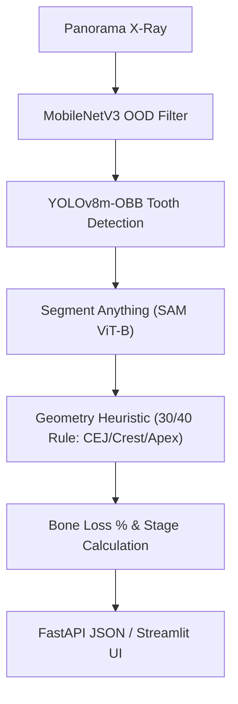

    

# Pano Bone Loss Measurement (Dental_003)

## 개요
> [학습 환경 사양] 실질적 모델 학습은 RTX 5080 + 라이젠9-6 9900X 환경에서 진행되었습니다.

딥러닝을 활용하여 파노라마 방사선 사진에서 치아를 검출(`YOLOv8m-OBB` / `YOLOv11-OBB`)하고, 제로샷 기반 마스킹(`SAM ViT-B`) 및 기하학적 휴리스틱 규칙(`geometric_heuristic_30_40_rule`)을 통해 주요 랜드마크(CEJ, Alveolar Crest, Root Apex)를 추출하여 치주염에 따른 치조골 소실량(RBL, Radiographic Bone Loss)과 병기(AAP/EFP Stage I~IV)를 산출하는 AI 시스템입니다.

## Model Weights (Hugging Face)
본 모듈의 학습된 가중치 모델은 Hugging Face 저장소에 연동되어 있습니다:
- [Hugging Face Repository (`chemahc94/Dental-AI-Models`)](https://huggingface.co/chemahc94/Dental-AI-Models/tree/main/Dental_003)
- [Hugging Face Repository (`chemahc94/pano-boneloss-weights`)](https://huggingface.co/chemahc94/pano-boneloss-weights)

FastAPI 서버(`api/main.py`) 및 Streamlit UI(`app.py`)는 로컬 `weights/` 또는 Hugging Face Hub에서 가중치를 지연 로드하며, 가중치가 존재하지 않을 경우 더미 가중치로 추론하지 않고 명시적으로 `HTTP 503 (Model weights unavailable)`을 반환합니다.

## 설치 및 실행 방법

1. 의존성 설치 및 환경 구성:
   ```bash
   pip install -r requirements.txt
   python scripts/setup_env.py
   ```
2. FastAPI 서버 실행:
   ```bash
   uvicorn api.main:app --host 127.0.0.1 --port 8003
   ```
3. Streamlit UI 실행:
   ```bash
   streamlit run app.py
   ```

## 주요 기능 및 계측 방식 (`geometric_heuristic_30_40_rule`)

### 분석 결과 예시


### Architecture Diagram


### 기하학적 랜드마크 산출 규칙 및 API 응답 명세
- `measurement_method`: `geometric_heuristic_30_40_rule`
  - SAM(`vit_b`)으로 추출된 개별 치아 마스크 윤곽선(Contour)에서 상악/하악 방향에 따라 치관 끝단(Crown)과 치근단(Root Apex)을 식별합니다.
  - 전체 치아 수직 길이(`abs(crown_y - root_y)`)를 기준으로 치관 방향에서 치근 방향으로 `30%` 지점의 좌우 외곽점을 `CEJ(백악법랑경계)`, `40%` 지점의 좌우 외곽점을 `Alveolar Crest(치조정)`로 추정합니다.
  - 본 방식은 키포인트 직접 회귀 모델이 아닌 마스크 윤곽선 기반 기하 휴리스틱 스크리닝 지표이므로, API 응답 페이로드에 `"measurement_method": "geometric_heuristic_30_40_rule"` 및 `"model_version": "yolov8m-obb+sam-b"`를 항상 명시합니다.

### 벤치마크 및 검증 현황 (10-Case Verification Status)
- 중앙 통합 테스트 스위트(`Dental_000/tests/tests_003`) 및 `Evaluator` 모듈을 통해 RBL 백분율 MAE, 랜드마크 좌표 MAE, R-squared 지표 및 AAP/EFP 2018 치주염 병기 판정(Stage I~IV, Localized/Generalized) 단위 검증(10케이스 시나리오 및 기하/병기 테스트)을 수행합니다.
- 현재 랜드마크 추출은 SAM 마스크 + 30%/40% 휴리스틱 규칙에 기반하며, 전문의 수동 주석 Keypoint GT 대비 정밀 임상 회귀 벤치마크는 후속 과제로 분리되어 있습니다.

## 학습 데이터셋 출처 및 라이선스 (Dataset Sources & License)
- [UFBA-UESC Dental Images Deep Dataset (`ufba-425` / Zenodo `4457648`)]:
  - 브라질 UFBA/UESC 대학에서 구축·공개한 파노라마 방사선 데이터셋 (Zenodo Record `4457648`, Mendeley Data `hxt48yk462`).
  - 데이터 라이선스: `CC BY 4.0` (Creative Commons Attribution 4.0 International).
- [Segment Anything Model (SAM)]:
  - Meta AI Research 공개 범용 분할 모델 (`Apache-2.0 License`).

## 코드 라이선스 (Code License)
본 저장소의 소스 코드는 MIT License 하에 배포됩니다. 자세한 내용은 [LICENSE](LICENSE) 파일을 참고하십시오.

## 연구용 실행 주의사항
- 기본 실행 주소: `127.0.0.1` (로컬 전용)
- 외부 공개/상용 배포 금지 및 오픈 데이터셋 외 민감 의료데이터 사용 금지
